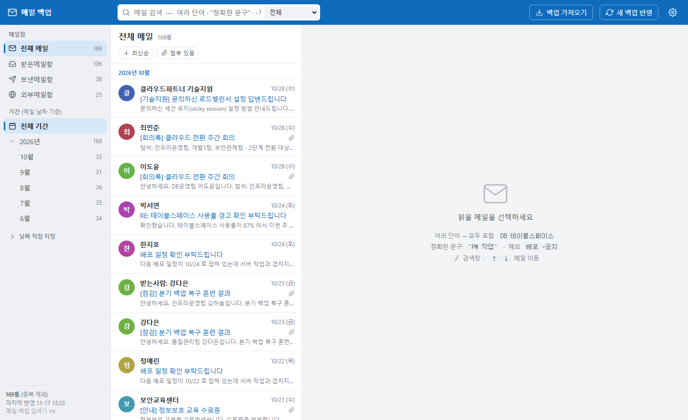
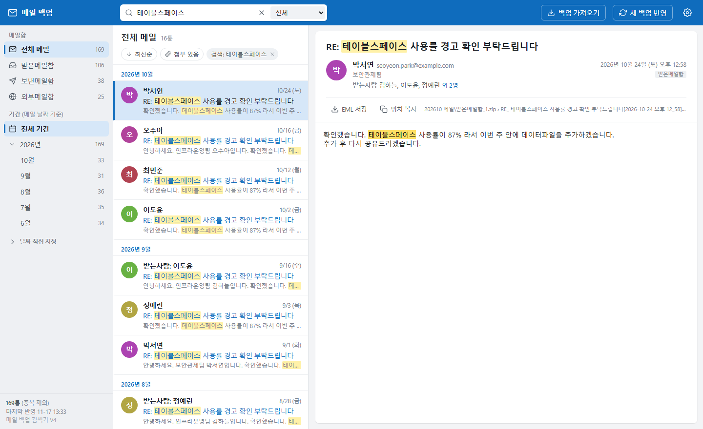
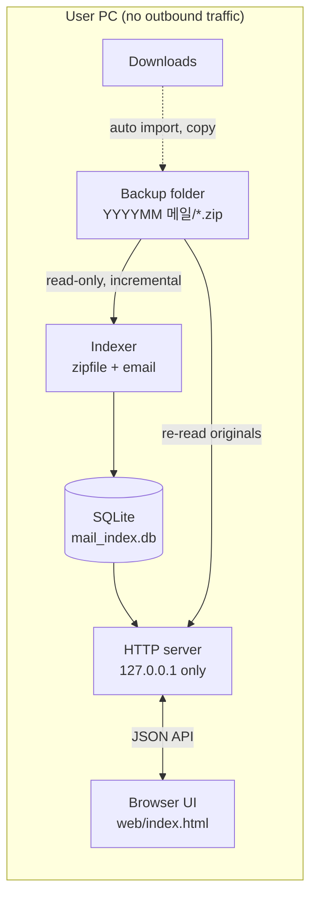

# Mail Backup Search

[](https://github.com/wyszkd93/X-unit-portfolio/actions/workflows/test.yml?query=branch%3AEMAIL)

[한국어](README.md) | **English**

A local web app for Windows that searches monthly mail-backup zip files **without extracting them**.
It uses only the Python standard library and ships with an embedded Python, so users just unzip and double-click.



> Screenshots use **fictional companies, people and mails** generated by [`make_demo.py`](make_demo.py). The UI is in Korean.
>
> 📄 Project overview (PDF, Korean, 6 pages): [docs/메일백업검색기_프로젝트소개.pdf](docs/메일백업검색기_프로젝트소개.pdf)

## Why

Because of a company security policy, the mail server keeps only recent mail; older mail arrives every month as a **zip backup of the previous month**.

- Finding one old mail meant extracting several months of zips and opening hundreds of `.eml` files.
- Zips are nested, and file names and bodies use `ks_c_5601-1987` (an EUC-KR alias), so Korean text often broke in common tools.
- The data is private mail, so uploading it to a cloud search service was not an option.

So I built a searcher that **runs only on my PC and only reads the backup files**.

## Features

| Feature | Description |
|---|---|
| Index without extracting | Reads zips (including nested zips) and loose `.eml` files into SQLite. Incremental: only new or changed files are re-read |
| Search | AND terms, `"exact phrase"`, `-exclude`; scope by subject, sender, recipients, body or attachment name |
| Outlook-style 3 panes | Mailboxes and a year/month tree · mail list with infinite scroll · preview with highlighted terms |
| Attachments and originals | Save attachments, show inline (cid) images, save the original `.eml` (opens in Outlook) |
| Import backups | Pick downloaded zips; the month is detected from mail dates and files are copied into `YYYYMM 메일\` |
| Auto import (optional) | New backup zips in the Downloads folder are imported within 5 minutes |
| No-install distribution | One zip including the Python embeddable package, plus .bat files for a desktop shortcut and start at login |



## Try it with demo data

```bash
python make_demo.py                          # creates 169 fictional mails under demo/
python mail_search.py --data-dir demo/data   # http://127.0.0.1:8790
```

For real backups, run `python mail_search.py` and pick the folder that holds the backup zips.
Append `#q=term` to the URL to search directly, e.g. `http://127.0.0.1:8765/#q=장애보고&open=1`.

## Tests

```bash
python -m unittest discover -s tests -v   # 26 tests, fake mails only
python tests/bench_search.py              # search timing (prints counts and times only)
```

- Covers indexing (nested zips, Korean encodings, incremental, dedupe, mailbox classification), search (AND, phrase, exclude, scope, filters, paging), import and auto import, HTTP security (Host, CSRF, CSP, attachment downloads) and .bat file rules.
- GitHub Actions runs them on every push on Windows with Python 3.9 and 3.14.

## Architecture



- **Index**: for each mail it stores subject, addresses, date, body text (up to 200 KB), attachment names and the source location (`zip path + path inside the zip`). Attachments and originals are re-read from the zip on demand.
- **Incremental**: `mtime / size` per file; only new or changed zips are read, and mails from deleted files are removed.
- **Dedupe**: the same mail in several backups is shown once, by `Message-ID`.

```
mail_search.py      server, indexer, search, import (single file, stdlib only)
web/index.html      UI (plain HTML/CSS/JS, no framework)
make_dist.py        builds the distribution zip (allowlist; aborts if private files slip in)
make_icon.py        generates the .ico in pure Python
make_demo.py        generates fictional backups for screenshots, demos and tests
tests/              unit tests and a search benchmark
*.bat               launcher / desktop shortcut / start-at-login on and off
.claude/            /동기화 (sync) command for Claude Code
```

## Problems I solved

### 1. Korean encodings
- Mails declare `ks_c_5601-1987` but contain CP949 extensions, so all related aliases are decoded as `cp949`.
- Zip entry names without the UTF-8 flag are read as `cp437` by Python; they are converted back to `cp949`.
- `email.utils.getaddresses` truncated in-house names like `"홍길동(Gildong)/개발팀" <a@b.com>`, so headers are cleaned up manually.

### 2. Securing a local web app
It handles raw mail, so other web pages open on the same PC are treated as a threat too.

| Threat | Mitigation |
|---|---|
| Other machines on the network | Bind to `127.0.0.1` only |
| DNS rebinding | Reject requests whose `Host` is not `127.0.0.1` / `localhost` |
| CSRF from other sites | Every POST needs a custom `X-Requested-With` header, plus an `Origin` check |
| Scripts in mail bodies | Bodies render in a `sandbox` iframe with `Content-Security-Policy: default-src 'none'` |
| Attachments | Only some image types inline; everything else is a download (`nosniff`) |
| Arbitrary file copy | Import accepts only paths returned by the server's own file dialog |

### 3. "Unzip and double-click" distribution
- **No Python on the PC**: bundles the python.org embeddable package (~12 MB), verified against the official SHA256.
- **Broken Korean in .bat files**: both `chcp 65001` and CP949 broke depending on the console code page. The .bat files are **ASCII only**, and Korean dialogs are shown via `powershell -EncodedCommand` (UTF-16LE Base64). `make_dist.py` checks ASCII and CRLF.
- **Folder dialog**: the embeddable package has no tkinter, so PowerShell `FolderBrowserDialog` / `OpenFileDialog` are used, with tkinter as a fallback.

### 4. Two servers on one port on Windows
`http.server` enables `SO_REUSEADDR`, which on Windows **lets a second process bind a port already in use**. When start-at-login and a manual start overlapped, two servers wrote to the same index. On Windows it now uses `SO_EXCLUSIVEADDRUSE`; a second start exits quietly or opens the existing page.

### 5. Removing the monthly chores
- **Import**: reads only the `Date` headers of up to 300 mails per zip and picks the most common month.
- **Auto import**: waits until a downloading file is unchanged for a minute, remembers processed files by `name|size|mtime`, strips the browser's ` (1)` suffix, and skips files whose **content (SHA-256)** already exists even under another name. Originals are never touched.
- **Mailbox for old backups**: when a backup has no mailbox info, mails from "me" (the most frequent sender in Sent) go to Sent, everything else to Inbox.

## Privacy principles

- No outbound traffic; it never connects to the mail server or groupware.
- Backup files are only read; import copies and never deletes originals.
- The index (`mail_index.db`) contains mail bodies and is excluded from the distribution zip and git (`.gitignore`, the allowlist and checks in `make_dist.py`).

## Building the distribution zip

The `python/` runtime folder is not in the repository because of its size.

1. Download [python-3.14.10-embed-amd64.zip](https://www.python.org/ftp/python/3.14.10/python-3.14.10-embed-amd64.zip) and extract it into `python/`.
   SHA256: `90905e64a840557d8c1bc4f5b74db3d7ee85e3ffb217611cac1c7813acea4159`
2. Bump `APP_VERSION` in `mail_search.py` and run `python make_dist.py` to get `배포/메일백업검색기_<version>.zip`.

## Environment

- Windows 10, Python 3.9+ (the distribution uses the 3.14 embeddable package)
- No third-party libraries: `http.server`, `sqlite3`, `zipfile`, `email`
- Built together with [Claude Code](https://claude.com/claude-code); `.claude/skills` has a `/동기화` command that re-indexes backups.

## License

[MIT](LICENSE)
