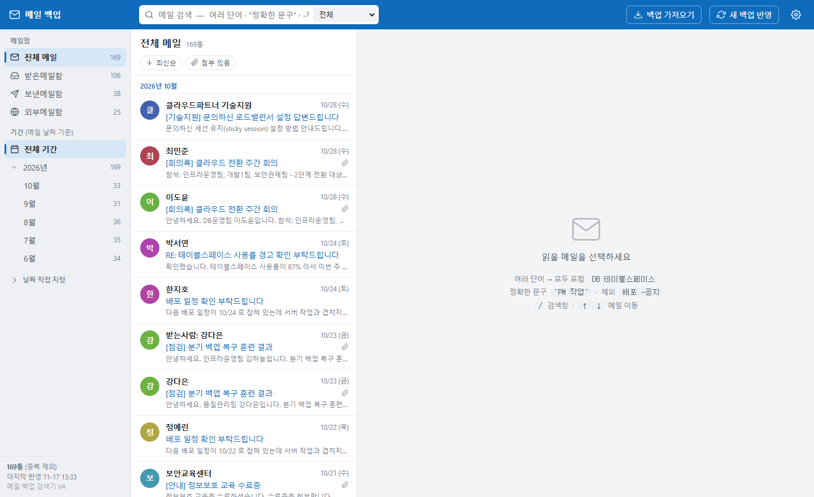
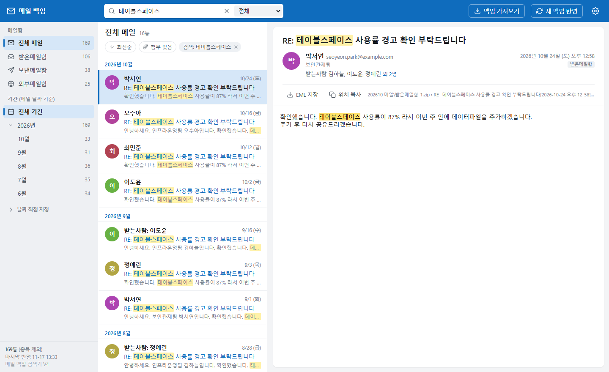
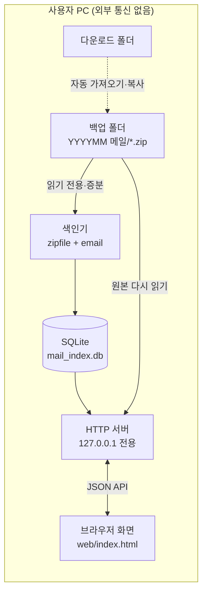

# 메일 백업 검색기

**한국어** | [English](README.en.md)

매달 zip 으로 받는 메일 백업을 **압축을 풀지 않고** 바로 검색하는 Windows 용 로컬 웹 앱입니다.
Python 표준 라이브러리만 사용하며, Python 설치 없이 zip 을 풀고 더블클릭하면 실행됩니다.



> 스크린샷은 [`make_demo.py`](make_demo.py) 로 만든 **가상의 회사·사람·메일** 입니다.
>
> 📄 프로젝트 소개서 (PDF, 6쪽): [docs/메일백업검색기_프로젝트소개.pdf](docs/메일백업검색기_프로젝트소개.pdf)

## 왜 만들었나

회사 보안 정책으로 메일 서버에는 최근 메일만 남고, 지난 메일은 매달 **전월 메일 백업(zip)** 으로 받습니다.

- 지난 메일 하나를 찾으려면 여러 달의 zip 을 풀어서 `.eml` 수백 개를 하나씩 열어 봐야 했습니다.
- zip 안에 zip 이 들어 있고, 파일 이름과 본문은 `ks_c_5601-1987`(EUC-KR 계열) 인코딩이라 일반 도구로는 한글이 자주 깨졌습니다.
- 메일 내용이 담긴 파일이라 외부 서비스나 클라우드 검색 도구에 올릴 수 없었습니다.

그래서 **내 PC 안에서만 동작하고, 백업 파일은 건드리지 않고 읽기만 하는** 검색기를 만들었습니다.

## 주요 기능

| 기능 | 설명 |
|---|---|
| 압축 해제 없는 색인 | zip(중첩 zip 포함)과 풀린 `.eml` 을 그대로 읽어 SQLite 에 색인. 바뀐 파일만 다시 읽는 증분 색인 |
| 검색 | 여러 단어 AND, `"정확한 문구"`, `-제외어`. 제목·보낸사람·받는사람·본문·첨부파일명 범위 지정 |
| Outlook 형 3단 화면 | 메일함 / 연·월 트리 · 메일 목록(무한 스크롤) · 본문 미리보기(검색어 강조) |
| 첨부·원본 | 첨부 파일 저장, 본문 속 이미지(cid) 표시, 원본 `.eml` 저장(Outlook 에서 열림) |
| 백업 가져오기 | 받은 zip 을 고르면 메일 날짜로 연월을 판단해 `YYYYMM 메일\` 폴더로 복사 후 반영 |
| 자동 가져오기 (선택) | 다운로드 폴더에 새 백업 zip 이 생기면 5분 안에 자동으로 가져와 반영 |
| 설치 없는 배포 | Python embeddable 패키지를 함께 넣은 zip 하나. 바탕화면 바로가기·로그인 시 자동 실행 bat 제공 |



## 빠르게 실행해 보기 (데모 데이터)

```bash
python make_demo.py                          # 가상의 메일 백업 169통 생성 → demo/
python mail_search.py --data-dir demo/data   # http://127.0.0.1:8790
```

실제 백업으로 쓸 때는 `python mail_search.py` 를 실행하고, 처음 뜨는 창에서 백업 zip 을 모아 둔 폴더를 고르면 됩니다.
주소에 `#q=검색어` 를 붙이면 바로 검색됩니다. 예) `http://127.0.0.1:8765/#q=장애보고&open=1`

## 구조



- **색인**: 메일마다 제목·주소·날짜·본문(텍스트화, 최대 200KB)·첨부 이름과, 원본 위치(`zip 경로 + zip 안 경로`)만 저장합니다. 첨부와 원본은 필요할 때 zip 에서 다시 읽습니다.
- **증분 색인**: 파일별 `mtime / size` 를 기록해 새로 들어오거나 바뀐 zip 만 다시 읽고, 사라진 파일의 메일은 지웁니다.
- **중복 제거**: 같은 메일이 여러 백업에 들어 있으면 `Message-ID` 기준으로 하나만 보여 줍니다.

```
mail_search.py      서버 · 색인기 · 검색 · 가져오기 (단일 파일, 표준 라이브러리만)
web/index.html      화면 (프레임워크 없이 HTML/CSS/JS 한 파일)
make_dist.py        배포 zip 만들기 (허용 목록 방식, 개인 파일 포함 시 중단)
make_icon.py        아이콘(.ico) 을 순수 Python 으로 생성
make_demo.py        스크린샷·시연용 가짜 메일 백업 생성
*.bat               실행 / 바탕화면 바로가기 / 자동 실행 켜기·끄기
.claude/            Claude Code 용 /동기화 명령
```

## 기술적으로 고민한 점

### 1. 한글 인코딩
- 메일 시스템이 `ks_c_5601-1987` 을 선언하지만 실제로는 CP949 확장 문자가 섞여 있어, 관련 별칭을 모두 `cp949` 로 읽도록 매핑했습니다.
- zip 파일 이름은 UTF-8 플래그가 없으면 `cp437` 로 해석되므로, 다시 `cp949` 로 복원합니다.
- `email.utils.getaddresses` 는 `"홍길동(Gildong)/개발팀" <a@b.com>` 같은 사내 표기에서 이름을 잘라 버려서, 헤더를 직접 정리하도록 바꿨습니다.

### 2. 로컬 웹 앱의 보안
메일 원문을 다루기 때문에 "내 PC 의 다른 웹페이지" 도 위협으로 보고 설계했습니다.

| 위협 | 대응 |
|---|---|
| 같은 네트워크의 다른 PC | `127.0.0.1` 에만 바인딩 |
| DNS 리바인딩 | `Host` 헤더가 `127.0.0.1` / `localhost` 가 아니면 거부 |
| 다른 사이트에서의 요청 위조(CSRF) | 모든 POST 에 커스텀 헤더 `X-Requested-With` 필수 + `Origin` 검사 |
| 메일 본문 속 스크립트 | 본문은 `sandbox` iframe + `Content-Security-Policy: default-src 'none'`, 스크립트 실행 불가 |
| 첨부 파일 | 이미지 일부만 인라인 표시, 나머지는 항상 다운로드(`nosniff`) |
| 임의 경로 복사 | 가져오기는 서버가 띄운 파일 선택 창이 돌려준 경로만 허용 |

### 3. "설치 없이 더블클릭" 배포
- **Python 없는 PC**: python.org 의 embeddable 패키지(약 12MB)를 함께 넣었습니다. 받은 파일은 공식 SHA256 과 대조했습니다.
- **bat 파일 한글 깨짐**: `chcp 65001`, CP949 저장 모두 콘솔 코드페이지에 따라 깨졌습니다. bat 은 **ASCII 만** 쓰고, 한글 안내 창은 `powershell -EncodedCommand`(UTF-16LE Base64) 로 띄우게 바꿨습니다. `make_dist.py` 가 bat 의 ASCII·CRLF 여부를 검사합니다.
- **폴더 선택 창**: embeddable 패키지에는 tkinter 가 없어, PowerShell `FolderBrowserDialog` / `OpenFileDialog` 를 쓰고 tkinter 는 대체 수단으로 남겼습니다.

### 4. Windows 에서 같은 포트에 서버가 두 개 뜨는 문제
`http.server` 는 `SO_REUSEADDR` 를 켜는데, Windows 에서는 이 옵션이 **이미 사용 중인 포트에도 바인딩을 허용**합니다. 로그인 자동 실행과 수동 실행이 겹치면 서버가 두 개 떠서 색인 DB 를 동시에 썼습니다. Windows 에서는 `SO_EXCLUSIVEADDRUSE` 를 쓰도록 바꾸고, 이미 떠 있으면 조용히 종료하거나 기존 화면을 엽니다.

### 5. 매달 반복 작업 없애기
- **백업 가져오기**: zip 안 메일의 `Date` 헤더만 최대 300통 읽어 가장 많은 연월로 폴더를 정합니다.
- **자동 가져오기**: 다운로드 중인 파일은 1분간 변화가 없을 때까지 기다리고, 이미 처리한 파일은 `이름|크기|수정시각` 으로 기억합니다. 브라우저가 붙인 ` (1)` 은 떼고, 이름이 달라도 **내용(SHA-256)이 같으면** 건너뜁니다. 원본은 항상 그대로 둡니다.
- **메일함 분류**: 메일함 정보가 없는 옛 백업은 보낸사람이 "나"(보낸메일함에서 가장 많이 보낸 주소)이면 보낸메일함, 아니면 받은메일함으로 분류합니다.

## 개인정보 원칙

- 외부로 나가는 통신이 없습니다. 메일 서버나 그룹웨어에도 접속하지 않습니다.
- 백업 파일은 읽기만 합니다. 가져오기는 복사이며 원본을 지우지 않습니다.
- 색인(`mail_index.db`)에는 메일 본문이 들어 있어, 배포 zip·git 에서 제외합니다 (`.gitignore`, `make_dist.py` 의 허용 목록과 검사).

## 배포 zip 만들기

`python/` 폴더(실행용 Python)는 용량 때문에 저장소에 넣지 않았습니다.

1. [python-3.14.10-embed-amd64.zip](https://www.python.org/ftp/python/3.14.10/python-3.14.10-embed-amd64.zip) 을 받아 `python/` 폴더에 풉니다.
   SHA256: `90905e64a840557d8c1bc4f5b74db3d7ee85e3ffb217611cac1c7813acea4159`
2. `mail_search.py` 의 `APP_VERSION` 을 올리고 `python make_dist.py` 를 실행하면 `배포/메일백업검색기_<버전>.zip` 이 만들어집니다.

## 개발 환경

- Windows 10, Python 3.9 이상 (배포판은 3.14 embeddable)
- 외부 라이브러리 없음: `http.server`, `sqlite3`, `zipfile`, `email`
- [Claude Code](https://claude.com/claude-code) 와 함께 개발했습니다. `.claude/skills` 에 색인 반영용 `/동기화` 명령이 있습니다.

## 라이선스

[MIT](LICENSE)
